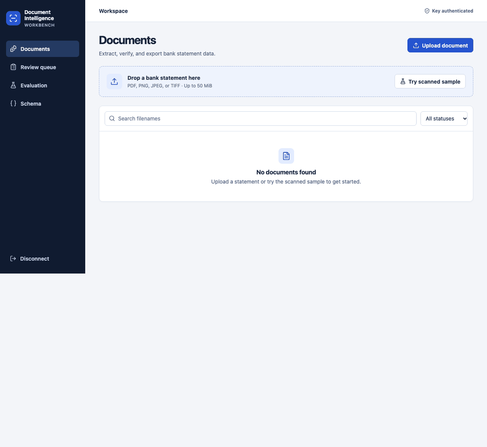

# Document Intelligence Workbench

Document Intelligence Workbench turns English-language USD bank statements into structured data. The browser console lets reviewers inspect extracted values against the original page, resolve discrepancies, and export completed statements as JSON or CSV.

## What it does

- Extracts text from native PDFs and uses local OCR for scans. It accepts PDF, PNG, JPEG, and TIFF files up to 50 MiB.
- Links extracted fields to their source regions so reviewers can check the original date, amount, or balance.
- Checks required fields, running balances, and statement totals. It also flags likely transaction rows that it could not map, even when the totals reconcile.
- Records approvals and corrections in an audit history. Each change triggers validation, and unresolved issues block export.

## Run the demo

You’ll need Docker with Compose v2, OpenSSL, and a browser. From the project directory, run:

```sh
test -f .env || printf 'WORKBENCH_DB_PASSWORD=%s\n' "$(openssl rand -hex 24)" > .env
docker compose up --build -d
docker compose exec api python -m workbench.db create-key --name "Demo workspace"
```

Open the [local console](http://127.0.0.1:8080) and enter the generated API key.

1. Select **Try scanned sample** to upload a fictitious two-page statement.
2. Select **Inspect** on the transaction 3 balance issue. The highlighted source amount reads `(160.27)`.
3. The balance moves from `6110.22` to `5939.95`, so enter `-170.27` and record the calculation in the review note.
4. Open **History** to see the before and after values, then download the corrected JSON or CSV.



Run `docker compose down` to stop the local stack. The database volume is retained.

## How it works

FastAPI stores the upload and queues processing in one PostgreSQL transaction. A background worker sends pages to an isolated parser for text extraction or OCR, then maps fields to source regions and validates the statement. The processing service runs locally without external model calls.

JSON exports contain the versioned statement data and field-level provenance. CSV exports contain the transaction table. See the [HTTP API](docs/api.md) for upload, review, and export examples and the [operations guide](docs/operations.md) for development and deployment instructions.

## Verification

| Check | Result |
| --- | --- |
| Backend suite | 35 passed |
| Browser suite | 2 passed |
| Frozen synthetic benchmark | 25 of 30 exact and 25 of 30 completed without review |
| Transaction cell F1 on the synthetic benchmark | 99.4% |

The synthetic benchmark covers native PDFs, rotated and degraded scans, debit and credit columns, multiple pages, and intentionally incorrect amounts. In a separate browser regression, a two-page statement contained two unmapped transactions that canceled each other out. The app identified page two, routed the document to review, and blocked both export formats. See the [evaluation methodology](docs/evaluation.md) for how these results were measured.

## Supported layouts

The extractor expects recognizable bank statement columns and enough spacing to distinguish cells. Unfamiliar layouts, merged cells, and handwriting may require manual verification or a clearer source. The benchmark measures performance on generated statements. Accuracy across real bank layouts and human handwriting has not been established.

## Repository history

The initial commits were reconstructed from an existing working tree. Their dates were assigned retrospectively.
